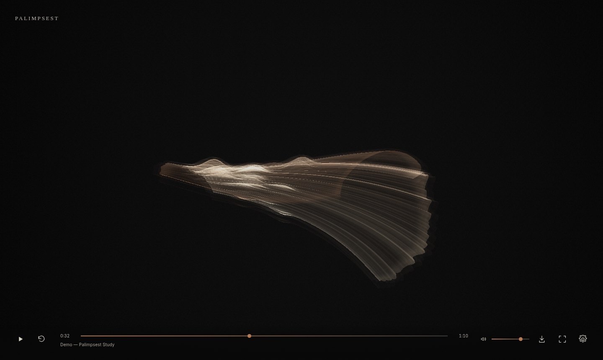

# PALIMPSEST

*Every sound leaves a scar. Every song builds a different world.*

A browser-only generative music visualiser. Play a track and a translucent membrane grows in the dark: the present is a bright, flexing lip; everything already heard remains as dimmer folded strata behind it. When the music ends, the finished sculpture stays on screen for viewing and PNG export.

Built with Vite, strict TypeScript, p5.js 2 (instance mode, WEBGL, custom GLSL), and the Web Audio API. No backend, no accounts, no external services — uploaded audio never leaves the device.



## Running

Requires Node 20+.

```bash
npm install
npm run dev        # http://localhost:5173
npm run build      # tsc --noEmit && vite build -> dist/
npm run preview    # serve the production build
npm run typecheck
```

Open the page, then **Try with sound** (a procedurally generated 70 s study) or **Choose audio** / drag a file anywhere onto the page.

Keyboard: `Space` play/pause · `F` fullscreen · `Home` restart · `M` toggle visual mode · `←`/`→` seek 5 s (`Shift` = 15 s).

## How sound becomes shape

`src/audio/engine.ts` owns one `AudioContext`, one `<audio>` element, one `MediaElementAudioSourceNode → AnalyserNode (FFT 2048) → GainNode` chain. Uploaded files and the generated demo both go through it as blob URLs.

Each frame it derives, against the real sample rate and bin width:

| Feature | Source | Visual role |
| --- | --- | --- |
| Bass (20–150 Hz) | band mean | Broad bends, shell radius and curvature, live flex of the newest layers (scaled by **Tension**) |
| Low-mid (150–600 Hz) | band mean | Membrane width and fold depth (corrugation amplitude) |
| High-mid (600 Hz–4 kHz) | band mean | Contour-strata brightness and density |
| Treble (4–16 kHz) | band mean | Fine etched lines and a small surface ripple (scaled by **Detail**) |
| Spectral centroid | log-scaled ~100 Hz–8 kHz | Slow colour drift between ivory and copper/oxide; restrained petrol-blue interference |
| Onset | half-wave-rectified spectral flux | A local seam: a brief bulge and bright line at a seeded position across the sheet |
| Spectral change | distance from a long-term spectrum | Gradual re-orientation of the growth axis |
| RMS | time domain | Overall layer luminance; silence gate |

Every feature has a noise floor, a minimum adaptive peak (so quiet material is not stretched into drama), clamped adaptive normalisation, and attack/release smoothing. Below the RMS gate all features fall to zero: silence leaves a faint, nearly still thread rather than amplified noise (see `docs/screenshots/test-silence.jpg`). Onset detection is only spectral flux — it is not BPM or beat tracking.

## Bounded visual memory

`src/visual/membrane.ts` samples the features at **24 rows per second of audio time** (not frame count). Each row is written once into a `Float32Array` ring buffer (16 values per row) and never changes — that row is the scar the moment left.

- The ring holds at most **90 s** of rows (2,160). Older rows are discarded with their geometry.
- **Memory** chooses how much of that is visible: 10 s at 0, the full 90 s at 1. Older visible rows fade by age.
- Rows are meshed in retained `p5.Geometry` chunks of 24 rows with a custom `aLoud` vertex attribute; only the live chunk rebuilds every frame. Settings that change geometry (Tension, Detail, Quality) rebuild old chunks within a per-frame budget.
- Growth only happens while audio is actually advancing. Pause freezes it; a frame gap over 0.35 s (e.g. returning from a background tab) is skipped rather than back-filled with invented samples, and catch-up is capped at 4 rows per frame.
- Restart, seek and new tracks clear the history. A small hint explains this on seek: *Seeking clears the memory — the shape regrows from here.*
- The visual seed comes from the file's name, size and modification time (fixed for the demo), so a track tends to grow a related form. Replay is not guaranteed to be identical because analysis depends on real-time frame timing.

The camera keeps the newest edge oriented consistently and slowly reframes the bounding sphere of the visible history. **Camera** = gentle drift or still; **Reduced motion** (defaults to `prefers-reduced-motion`) removes drift, damps live flex and onset disturbance, slows reframing and freezes grain.

## Rendering and quality

The membrane is drawn additively into a depth-less framebuffer, then composited with a tone map, vignette, optional glow and subtle grain.

| Quality | Columns per row | Row step | Max pixel density | Scene scale | Glow taps |
| --- | --- | --- | --- | --- | --- |
| Low | 48 | 2 | 1 | 0.7 | 0 |
| Medium (default) | 96 | 1 | 1.5 | 1 | 6 |
| High | 144 | 1 | 2 | 1 | 12 |

`window.__palimpsest.stats` exposes fps, rows, chunks, vertices and canvas/scene sizes for inspection.

## Verification (actual results)

Tested in Chrome via CDP automation on a Linux VM **with software WebGL (SwiftShader, no GPU)** at 1440×860, so absolute frame rates are pessimistic.

1. **Demo audio** — generated offline (OfflineAudioContext → 16-bit WAV, peak-normalised below clipping), played through the shared element path; `currentTime` advanced and the membrane grew (171 rows at 7 s, 1,676 at 70 s). Sampled analysis: bass 0.995 at 19.6 s (pulse section), treble 0.954 with onset 1.0 at 52.4 s (percussion), silence gate active from 69.6 s.
2. **Upload** — file picker and a synthetic `DataTransfer` drop loaded a local WAV; title shown from filename. A native OS drag was not performed.
3. **Quiet vs loud** — a −70 dB noise file produced only a faint dim thread; loud material produced bright, full folds (`test-silence.jpg` vs the demo screenshots).
4. **Band separation** — a 55/82 Hz test tone produced broad scalloped folds and strong curvature (`test-bass.jpg`); high-passed noise bursts + 6 kHz produced a narrow sheet with bright fine etching and seams (`test-treble.jpg`).
5. **Persistent history** — at 0:32 with Memory 1, 706 rows are visible as dim strata behind the head; Memory 0 shows only the last 241 rows (`demo-32s-memory-*.jpg`).
6. **Transport** — pause: row count unchanged after 3 s; resume: +19 rows after 1 s (no jump); seek to 50 %: history reset to 1–2 rows and regrew (75 rows 3 s later), hint shown; arrow keys seek ±5 s; `Home` restarts at 0:00 with cleared history; track replacement resets.
7. **End of track** — after `ended` the rows remain, the control shows *Replay*, and the artwork stays visible (`demo-ended.jpg`).
8. **PNG export** — downloaded `palimpsest-<title>-<m>-<ss>.png` at full canvas size; non-blank (26,852 pixels above luminance 40).
9. **Fullscreen / resize** — `F` entered and left fullscreen; resizing to 900×700 resized canvas and framebuffer.
10. **Quality cost** (same paused state): Low 4,032 vertices, 1008×602 scene, 23.5–34 fps · Medium 15,360 vertices, 1440×860, 15.8 fps · High 23,040 vertices, 11.7 fps.
11. **Repeated track changes** — 8 consecutive uploads: chunks stayed at 2–4 and JS heap fluctuated 27–47 MB with no upward trend; object URLs are revoked on replacement.
12. **Build** — `npm run build` passes (strict `tsc` + Vite) with no console errors or failed requests during the runs above. Tension and Detail were also checked by screenshot comparison.

## Known limitations

- Performance was measured only on software WebGL; on a CPU rasteriser a long, full-memory history at Medium runs at ~10 fps (167k vertices). Real GPUs should be far faster but were not measured here. Use Low on weak hardware.
- WebGL2 is required; without it an error message is shown.
- Some browsers cannot decode certain formats (decoding is the browser's); failures surface as a toast.
- Memory is bounded at 90 s, so long tracks keep only their most recent 90 s as visible strata.
- The Detail setting is deliberately subtle — it changes fine etching and surface ripple, not the overall silhouette.
- The p5 bundle is ~1.2 MB (355 kB gzipped).
- No microphone mode.
